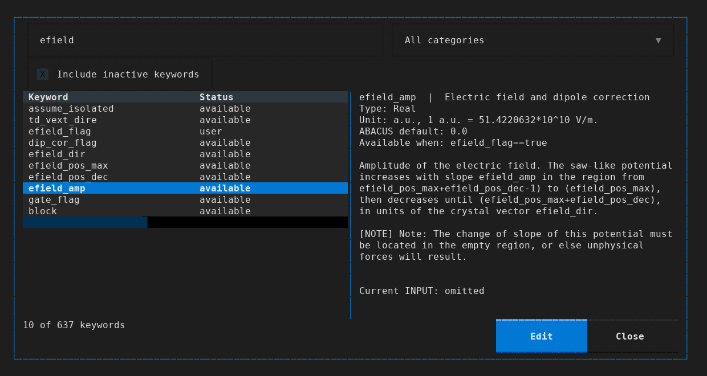

# ABACUS Kit

ABACUS Kit is an interactive terminal editor for ABACUS calculation inputs.
It uses ASE for crystal structures and Textual for the editor. The parameter
catalogue comes from the ABACUS reader.

```sh
python -m pip install git+https://github.com/Stardust0831/abacus-kit.git
abacus-kit
```

The editor starts with a two-atom Si crystal. Attach a Si pseudopotential in
the table, or start with `abacus-kit --pseudo Si=/path/to/Si.upf`. Use
**Crystal**, **Supercell** or **Import** to prepare a different structure.
The INPUT, STRU and KPT tabs preview the files before export.

Press **P** to search all registered INPUT keywords by name, description or
category. **Include inactive keywords** shows entries requiring a different
configuration, together with their conditions. Press Enter on an available
row to edit it. **Use default** releases a manual setting. Changing the task
rebuilds its dependent settings on the current structure. The Changes tab
records the old and new values and their sources.



For example, switch on `efield_flag` in the catalogue, set `efield_amp`, and
inspect INPUT. Turning the field off removes the amplitude from the preview.
The DeePMD controls follow the selected model's type map and parameter
dimensions. Supply `--deepmd-python /path/to/python` when DeePMD is installed
in a separate environment.

The bundled [parameter reference](docs/parameters.md) covers every registered
keyword at [ABACUS eba09c9](https://github.com/deepmodeling/abacus-develop/tree/eba09c937c734f3f4da52cbdbb9c55504846921a).
It includes 629 entries from the native documentation and eight additional
keywords registered by the reader. The terminal profiles provide 31
hierarchical controls. The remaining 606 entries are available for explicit
input and otherwise use the target ABACUS reader's omission behavior.

```sh
abacus-kit --list
abacus-kit --list thermostat
abacus-kit --describe mixing_restart
abacus-kit --manual
```

Use `--abacus /path/to/abacus` to check a staged copy before export. Binaries
with `--check-input-values` also support explicit-value comparison. Stock
builds with `--check-input` report reader acceptance. The generator checks
registered domains, known requirements and files it prepares. Solver build
options, restart data, feature-specific external files and convergence can
require additional preparation. Paths for generated structures, k-points and
their packaged assets are relative to the exported directory.

## Refresh the catalogue

Use a clean checkout of the intended ABACUS revision and a dedicated build
directory. The CMake include uses the upstream registry executable's build
dependencies. Its entry point also enumerates registered inputs omitted from
the upstream help output. Install PyYAML in the development environment.

```sh
cmake -S /path/to/abacus-develop -B /tmp/abacus-kit-registry \
  -DENABLE_MPI=OFF -DENABLE_LCAO=OFF -DCMAKE_PROJECT_INCLUDE="$PWD/tools/registry.cmake"
cmake --build /tmp/abacus-kit-registry --target abacus_input_yaml -j4
/tmp/abacus-kit-registry/source/source_io/abacus_input_yaml > /tmp/abacus-registry.yaml
python tools/sync_catalog.py /tmp/abacus-registry.yaml "$(git -C /path/to/abacus-develop rev-parse HEAD)"
python -m abacus_kit --manual > docs/parameters.md
python -m unittest discover -s tests
```

Pass `--check` to `sync_catalog.py` to verify the packaged snapshot.

The project uses the GNU LGPL v3. The structure-writing routines are adapted
from the [ABACUS ASE interface](https://github.com/deepmodeling/abacus-develop/tree/eba09c937c734f3f4da52cbdbb9c55504846921a/interfaces/ASE_interface).
